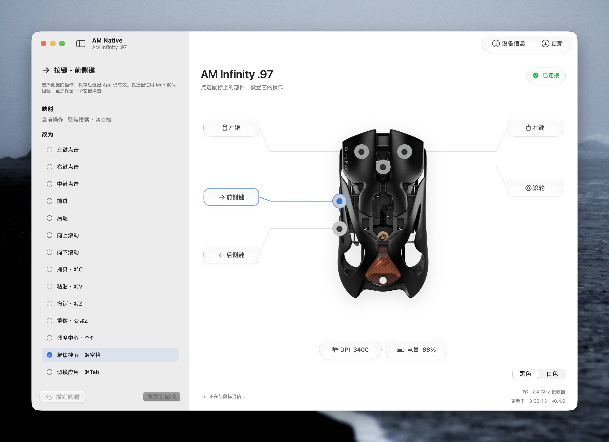

# AM Native



**中文** · [English](README.en.md)

为 **Angry Miao AM Infinity .97** 打造的原生 macOS 设置工具。直接读取电量、调整 DPI 和板载按键映射，让鼠标更适合 Mac 日常使用。

SwiftUI + AppKit 界面，通过 IOKit HID / CoreBluetooth 与设备通信，无需运行官方设置程序。

## 下载与安装

**[下载最新测试版（Apple Silicon）](https://github.com/op7418/AM-Native/releases/tag/v0.5.0)**

1. 下载 Release 中的 `AMNative-版本号-arm64-preview.zip` 并解压。
2. 把 `AM Native.app` 拖入“应用程序”文件夹，双击打开。
3. 退出官方怒喵程序及后台，并关闭官方鼠标设置网页。
4. 选择 **USB 直连、蓝牙或 2.4GHz 接收器**，移动或点击鼠标将它唤醒。蓝牙需先在 macOS 设置中配对并连接，首次打开 App 时允许蓝牙权限。界面显示“已连接”后即可设置。

### 首次打开提示无法验证开发者？

当前测试版只有 **ad-hoc 临时签名**，**没有 Developer ID 签名，未经过 Apple 公证**。

确认文件来自本仓库 Release 后，先尝试打开一次，再前往 **系统设置 → 隐私与安全性 → 仍要打开**，按系统提示确认。详见 [Apple 官方说明](https://support.apple.com/zh-cn/102445)。如果没有这个选项或提示文件已损坏，请通过 [Issues](https://github.com/op7418/AM-Native/issues) 附上截图反馈。

### 兼容范围

| 项目 | 当前支持情况 |
| --- | --- |
| Mac 芯片 | Apple Silicon（M 系列）；发布包不支持 Intel |
| 系统 | 程序声明最低 macOS 14；已实测 macOS 27；macOS 14–26 尚未实机验证 |
| 玻璃界面 | macOS 26 及以上；较早系统使用兼容样式 |
| 鼠标 | AM Infinity .97；其他型号未验证 |
| 连接 | 蓝牙、USB 直连和 2.4GHz 接收器均已通过实机读写恢复验证 |

## 怎么用

| 想做什么 | 操作 |
| --- | --- |
| 修改按键 | 点击鼠标图上的圆点或引导线标签，选择操作，点击“保存到鼠标” |
| 设置滚轮 | 点击滚轮，分别设置点击、向上、向下 |
| 调整 DPI | 点击底部 DPI，选择档位，调整 X/Y 后保存 |
| 查看电量 | 点击底部电量，查看电池与连接状态 |
| 恢复修改 | 使用“撤销”或“撤销映射”，恢复本次运行中的上一次成功修改 |
| 检查官方更新 | 右上“更新”，检查鼠标固件、接收器固件和官方 Mac 驱动 |
| 查看设备与备份 | 右上“设备信息” |
| 刷新连接 | 按 `⌘R`，或使用 View 菜单中的“刷新设备” |

只选择操作不会写入设备。点击保存后，App 会先备份，再写入并完整读回确认。DPI 和按键映射保存到鼠标后，**退出 App 仍然有效**。Mac 快捷键使用系统默认组合；自定义过系统快捷键时，实际效果可能不同。

黑白配色是手动外观选择，不代表硬件自动识别，也不改变灯光。侧栏可随时收起，再点击画布入口即可打开对应设置。

完整说明：[使用说明](docs/使用说明.txt)。

## 备份、更新与常见问题

**备份在哪里？** `~/Library/Application Support/AM Native/Backups/`，也可从“设备信息”打开。备份文件会保留；普通撤销记录仅在当前运行期间有效。出现“等待恢复”时，请保留提示和备份，按 App 中的恢复入口处理。

**接收器插着，却提示未连接？** 鼠标可能休眠。移动或点击实物鼠标，确认官方程序和设置网页已退出，再按 `⌘R`。只运行一个 AM Native 副本。

**如何切换连接？** 同时连接时按 USB → 蓝牙 → 2.4GHz 的顺序选择配置通道。切换后自动刷新，也可按 `⌘R`。蓝牙只连接系统中已经配对并连接的 AM Infinity .97；不会扫描或配对其他设备。若拒绝过权限，请在“系统设置 → 隐私与安全性 → 蓝牙”中允许 AM Native。切换连接后请重新读取再修改，旧连接的撤销记录会清空。

**会自动刷固件吗？** 不会。App 运行时每天检查一次官方版本，也可手动检查；只提醒并提供官方入口，不下载或安装固件/驱动。这里检查的是官方更新，并非 AM Native 自身的自动更新。

**是否需要一直运行？** 已保存的板载设置不需要 App 常驻。自动版本检查仅在 App 运行期间进行。

**还不支持哪些功能？** 手势、平滑滚动、按应用配置、灯光控制和固件刷写尚未实现。

## 从源码构建

需要 Apple Silicon Mac、完整 Xcode 及 **macOS 26 或更新 SDK**。普通用户直接下载安装包即可，不需要 Xcode。

```sh
git clone https://github.com/op7418/AM-Native.git
cd AM-Native
bash scripts/fetch-artwork.sh
bash build.sh
open 'build/AM Native.app'
```

`fetch-artwork.sh` 从 Angry Miao 官方站点下载鼠标展示图并验证哈希；图片归属见 [第三方说明](THIRD_PARTY_NOTICES.md)。源码未附带发布版图标时，构建会生成一个简洁的备用图标。

`build.sh` 会先运行协议、按键映射和原生控件测试，再生成 App 与命令行探针，并进行本地临时签名。构建不写入鼠标。可用 `AM_SWIFTC`、`AM_SDK` 覆盖默认工具链位置。

```sh
# 只读设备信息
build/am-probe read

# 打包当前构建（不覆盖已有同版本包）
bash package.sh
```

协议实现与验证边界见 [协议笔记](docs/protocol.md)。欢迎通过 Issues 提交复现步骤，或通过 PR 改进。涉及设备写入的修改，请说明目标硬件与恢复验证结果；不要在 Issue 中上传个人备份或日志中的敏感内容。

## 作者与许可

- 作者：**歸藏**
- Twitter：[@op7418](https://twitter.com/op7418)
- 项目代码：[MIT License](LICENSE)

本项目为独立开发的非官方工具，与 Angry Miao 无隶属关系。第三方产品图片、品牌与商标不属于本项目 MIT 许可范围，见 [THIRD_PARTY_NOTICES.md](THIRD_PARTY_NOTICES.md)。
